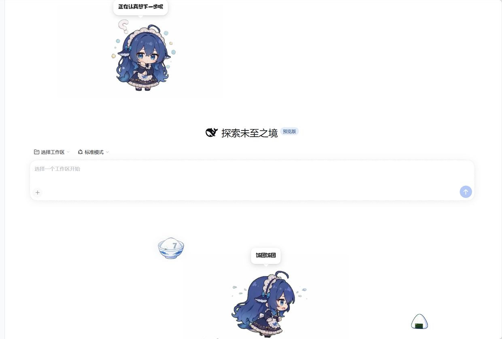
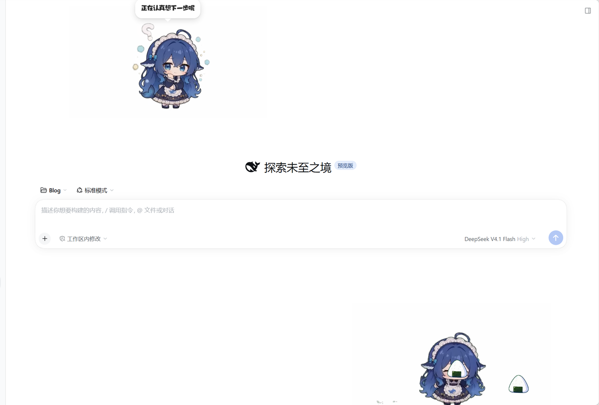

# dsh-pet-baifan · 吃白饭



dsh-pet（桌宠插件）的第三方扩展：右键桌宠 → **更多 → 吃白饭**，它就跑到屏幕底部等着，
米饭从天上一份份掉下来，追着吃到饱 —— 一直到被你把宠物拖走为止。

不自己养宠物、不画宠物：位移和动画全部借**你已经养的那只**（拿 dsh-pet 的占用锁指挥它），
页面里只多画米饭和头顶的分数。

## 安装 / 卸载

```powershell
# 本地开发：<repo> 换成 petE 的绝对路径，装的是链接（改完刷新即生效）
dsh plugin --profile web add "link:<repo>/baifan"
# 想装成不依赖本地目录的副本：先 npm pack，再 dsh plugin --profile web add .\dsh-pet-baifan-0.1.0.tgz
# 发布到 npm 之后：dsh plugin --profile web add dsh-pet-baifan

dsh plugin --profile web remove dsh-pet-baifan    # 卸（记得同时删掉 profile 里 bundles 的那一项）
```

包名、插件 id、客户端模块 id 都是 `dsh-pet-baifan`：这些都进全局命名空间（模块 id 撞了组合
直接失败，路由撞了直接抛错），带上前缀既表明它是 dsh-pet 的扩展，也不会被同名的通用词抢注。

装进 profile 后 `lib/` 是链接过去的，所以改代码只要**刷新页面**（Ctrl+F5）；只有宿主半侧
（`lib/index.js`）改动才需要重启 DSH。

## 怎么用

| 想干什么 | 怎么做 |
| --- | --- |
| 开一场 | 右键宠物 → 更多 → 吃白饭 |
| 让它停下 | **拖一下宠物**（占用锁被撤，当场收场，不用点菜单） |
| 重新来一场 | 再点一次「吃白饭」 |
| 看它吃了几份 | 吃完时头顶会弹分数气泡，图标跟着吃下去的东西变（碗饭 / 饭团） |

一场演出的顺序：跑到底部 → 原地蓄力 → 期待开饭 5 秒 → 米饭每 4.2 秒掉一份（场上最多 2 份）
→ 追着吃，吃完接着追。它会在这几个节拍上冒一两句台词（开饭、下去、等饭、掉落、吃完一口、
吃满 5 份）。38% 的概率掉的是碗饭，吃完还会掉个空碗下来。



## 依赖

- `dsh-pet` 必须在同一个 profile 里启用 —— 占用锁、菜单、动画、位置全在它那边；
- 宠物要在**网页**里显示（`display: web` 或 `both`），否则取锁会回 `pet-not-displayed`。

## 目录

```
dsh-pet-baifan/
├── package.json        # 包清单：宿主半侧入口 + dsh.client（web）+ dsh.bundle.patch
├── cordis.patch.yml    # 把 dsh-pet-baifan 这一层插进 DSH 配置树
├── lib/index.js        # 宿主半侧：把 assets/ 挂成 /dsh-pet-baifan/assets 前缀路由
├── lib/client.js       # 浏览器半侧：菜单、行为、米饭与分数
└── assets/
    ├── webm/           # 5 段动画（640×360 VP9-alpha）
    ├── pic/            # 3 张米饭图（碗饭 / 空碗 / 饭团）
    └── preview/        # README 用的截图，不随包发布
```

## 想改点什么

- **节奏**：`lib/client.js` 顶部的 `CFG`（掉饭间隔、跑速、位移时长、气泡时长…），每行都有注释。
- **台词**：同文件的 `LINES`，一组一句池，随机挑。
- **素材**：`assets/` 下的文件是 640×360 VP9-alpha；**重新编码素材后必须把 `lib/client.js`
  里的 `ASSET_V` 版本号 +1**，否则浏览器会用缓存里的旧片。
